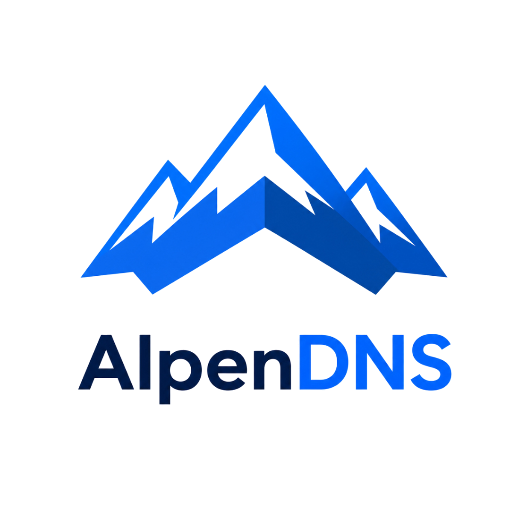
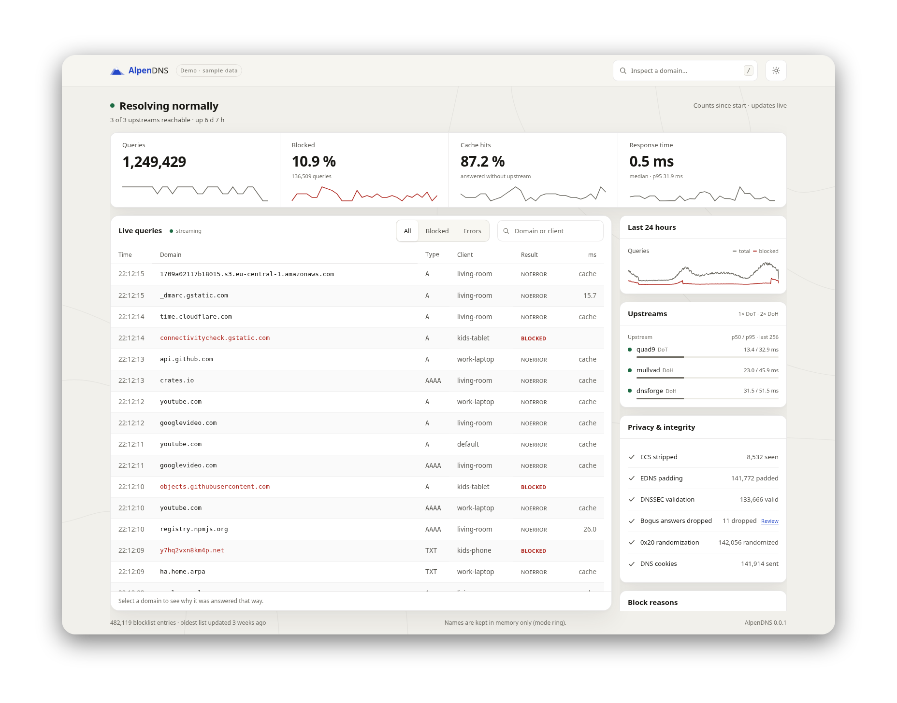

<div align="center">
  
</div>

<p align="center">
  <a href="https://florianpunz.github.io/AlpenDNS/"><b>Live demo</b></a> ·
  <a href="docs/OPERATIONS.md"><b>Install</b></a> ·
  <a href="docs/ROADMAP.md"><b>Roadmap</b></a> ·
  <a href="docs/ARCHITECTURE.md"><b>Architecture</b></a> ·
  <a href="LICENSE"><b>License</b></a>
</p>

A privacy-focused DNS server for Linux, in Rust. A **forwarding resolver**: it
accepts queries from the LAN, filters them against blocklists and policies, and
forwards them encrypted (DoT/DoH/DoQ) to upstreams. Recursion from the root
servers is deliberately not a goal.

<div align="center">
  
</div>

> **Status.** Feature-complete, in maintenance. Running in production in a
> homelab since August 2026. Where it stands, with numbers and open gaps:
> [docs/ROADMAP.md](docs/ROADMAP.md).

## About

Pi-hole and AdGuard Home solve "blocking ads on the LAN" well. AlpenDNS answers
the questions they leave open:

* **Your upstream still sees everything.** One encrypted upstream swaps a nosy
  provider for a nosy vendor. AlpenDNS spreads queries deterministically across
  several upstreams (`split_by_zone`), so no single one sees your whole profile.
* **Blocking is a black box.** "Why doesn't this site work?" is usually a search
  through the log. AlpenDNS emits a decision chain per answer: which list, which
  rule, which policy.
* **Filtering is purely list-based.** Lists know only what was known yesterday.
  AlpenDNS also evaluates locally, without the cloud: DGA, tunneling, rebinding,
  typosquatting against domains that matter to you.
* **Logging is on or off.** AlpenDNS aggregates by default behind a k-anonymity
  threshold: you see patterns, not who called what when.

Not to replace Pi-hole — to answer the questions it leaves open.

## What AlpenDNS can do

| | |
|---|---|
| Role | Forwarding resolver — no own recursion |
| Client transports | UDP/53, TCP/53 |
| Upstream transports | DoT, DoH, DoQ; cleartext only for explicit internal zones |
| Filtering | Blocklists (hosts, domains, wildcard), allowlists, regex rules |
| Own names | `[[local_zone]]`: a static table answered locally, plus `fallback = "nxdomain"` to keep a whole domain inside |
| Policies | per client (IP/subnet), time windows, temporary grants |
| Privacy | ECS stripping, padding, DNS cookies, 0x20, upstream splitting, DNSSEC, ODoH, aggregated logging |
| Heuristics | DGA, tunneling, rebinding, typosquatting, newly registered domains — all `flag`, block nothing |
| Operations | systemd unit, .deb, Prometheus metrics, web UI, rate limiting, SIGHUP reload |

Encrypted client listeners (DoT/DoH/DoQ) and client identification via DoH path
tokens or mTLS are planned, not built — policies distinguish clients by IP today.

## What AlpenDNS is not

* **Not recursive.** It queries upstreams, not the root servers; the slot where
  recursion would hook in stays open
  ([ADR-0003](docs/adr/0003-forwarder-first.md)).
* **Not authoritative.** To host a zone, use Knot or NSD. A `[[local_zone]]`
  is a static table of names answered in front of the resolver — no SOA, no NS,
  no transfer, no signing, and no `AA` in the answer
  ([ADR-0023](docs/adr/0023-lokale-zonen.md)).
* **Not a DHCP server.** Pi-hole does that too; that's a different job.
* **Not a VPN.** DNS privacy protects name resolution, not the connection after
  it — [docs/THREAT-MODEL.md](docs/THREAT-MODEL.md).

## Quick start

```bash
cargo run -- -c config/alpendns.minimal.toml
dig @127.0.0.1 -p 5353 example.com

# Why was something blocked? Works without a running server:
cargo run -- -c config/alpendns.minimal.toml policy test doubleclick.net
```

The web UI is on <http://127.0.0.1:8053>; the token sits in `api.token_file`.

### As a service

`cargo deb -p alpendns` builds the Debian package. Installation, the systemd
unit and the open-resolver warning are in
[docs/OPERATIONS.md](docs/OPERATIONS.md).

### Container

```bash
docker run -d --name alpendns \
  -p 53:53/udp -p 53:53/tcp \
  -p 8053:8053 -p 9153:9153 \
  -v alpendns-lib:/var/lib/alpendns \
  -v alpendns-cache:/var/cache/alpendns \
  ghcr.io/florianpunz/alpendns:latest
```

The image ships a configuration at `/etc/alpendns/alpendns.toml`; to use your
own, mount it there. The API token is created in `/var/lib/alpendns` on first
start and reached with `docker cp alpendns:/var/lib/alpendns/api.token .`.
Binding port 53 as the unprivileged container user works because Docker sets
`net.ipv4.ip_unprivileged_port_start=0`; where that setting is missing, add
`--cap-add NET_BIND_SERVICE`. The API shows query names, so publish port 8053
only on a trusted network. Volumes, upgrades and the rest:
[docs/OPERATIONS.md](docs/OPERATIONS.md#container).

## Documentation

* [Operating](docs/OPERATIONS.md) — install, upgrade, backup, troubleshooting
* [Roadmap](docs/ROADMAP.md) — current state, acceptance criteria, open items
* [Architecture](docs/ARCHITECTURE.md) — structure, request pipeline, data model
* [Features](docs/FEATURES.md) · [Testing](docs/TESTING.md) ·
  [Benchmarks](docs/BENCHMARKS.md) · [Threat model](docs/THREAT-MODEL.md) ·
  [Decisions](docs/adr/)
* [Configuration reference](config/alpendns.example.toml) — the full format,
  including sections not yet implemented, marked `[not implemented — backlog]`

The [live demo](https://florianpunz.github.io/AlpenDNS/) is this web UI with
recorded data, no install — built from [`web/demo/`](web/demo/).

## Development

Rust stable ([`rust-toolchain.toml`](rust-toolchain.toml) selects it).
[CONTRIBUTING.md](CONTRIBUTING.md) covers setup, the definition of done and
what a change must bring.

## License

[AGPL-3.0-or-later](LICENSE). The license is a deliberate choice: even someone
who only offers AlpenDNS as a network service must disclose the source of their
changes (AGPL §13) — that fits the project's privacy motivation.
